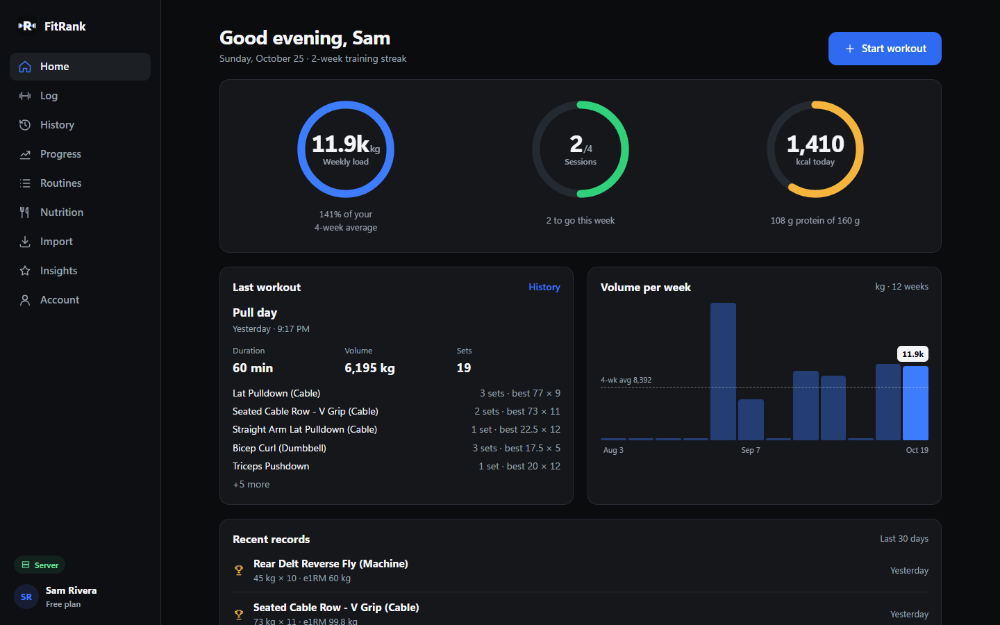
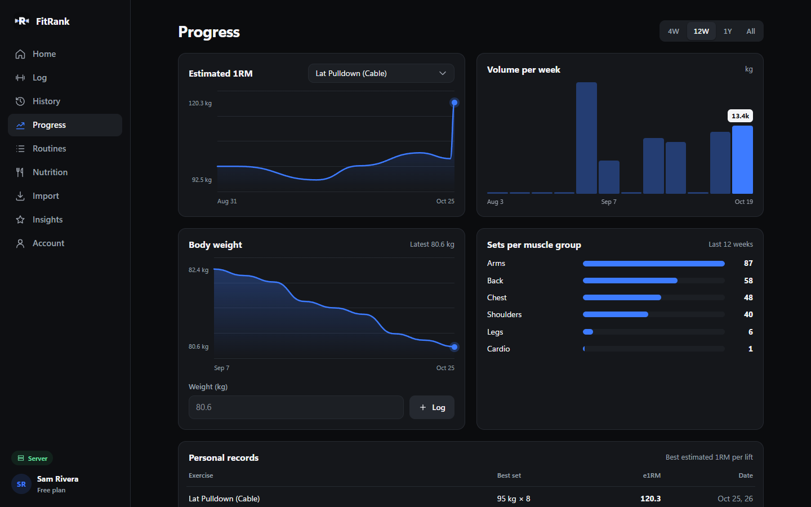
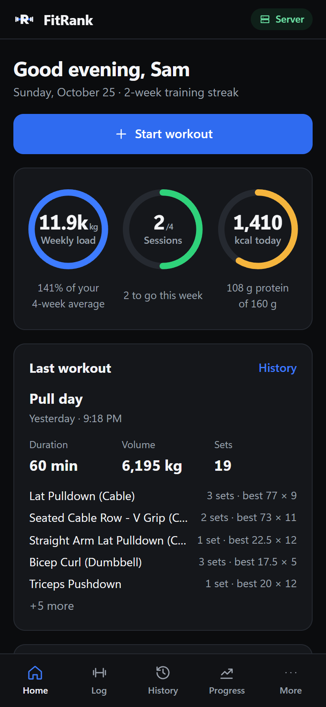
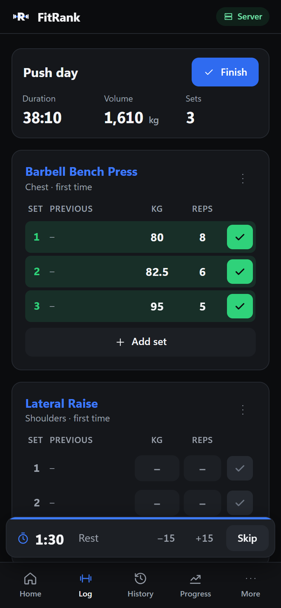

# FitRank

A personal workout tracker: log sets fast, import your Hevy and Apple Health history, and see real progress in charts.

- **Java API + PostgreSQL** when you run the server (accounts, data saved in the database).
- **Browser-only demo** on GitHub Pages, where no server is reachable. The app says which mode it is in, in the corner chip.

| Home (desktop) | Progress (desktop) |
| --- | --- |
|  |  |

| Home (iPhone) | Live logger (iPhone) |
| --- | --- |
|  |  |

Screenshots are headless-Chrome captures of the running app with the bundled sample data.

## Features

- **Home**: weekly load against your 4-week average, sessions against your weekly target, today's calories, last workout, weekly volume, recent personal records.
- **Live logger**: previous values from your own history, done-tick per set, PR detection by estimated 1RM, rest timer, reorder, replace or remove exercises. The draft survives a reload.
- **Routines**: build from 90+ exercises, or save any finished workout as a routine.
- **History**: grouped by month, expand all sets, repeat, rename, delete.
- **Progress**: estimated 1RM per lift (Epley), weekly volume, body weight, sets per muscle group, personal-record table. Ranges of 4 weeks, 12 weeks, 1 year or all.
- **Nutrition**: calories, protein and water against your own targets, 7-day chart.
- **Import**: Hevy workout CSV (or FitRank JSON), and Apple Health `export.xml`, which is streamed in the browser so large files work. You see a preview before anything is saved, and records already present are skipped.
- **Insights** (Premium): strength board, consistency pace, rule-based coaching notes from your logged sets, form cues in the logger.
- **Account**: profile, units (kg/lb), rest timer, targets, password change, JSON/CSV export, account deletion.
- **Admin**: totals, user search, plan changes, user deletion. Premium is assigned here; there is no payment flow.

## Run it

Requirements: JDK 8 or newer. PostgreSQL is optional.

```powershell
./start-fitrank.ps1
```

The script downloads the PostgreSQL JDBC driver on first run, compiles the backend, starts the server on http://localhost:8080 and opens it. The server also serves the web app, so there is nothing else to start.

Manual equivalent:

```powershell
cd backend
javac --release 8 -d out src/com/fitrank/app/*.java
java -cp "out;lib/postgresql.jar" com.fitrank.app.FitRankServer   # use ':' instead of ';' on macOS/Linux
```

On first start the server creates an admin account. Set `FITRANK_ADMIN_PASSWORD` to choose its password; otherwise a random one is printed to the console once.

### Configuration

| Variable | Default | Purpose |
| --- | --- | --- |
| `PORT` | `8080` | HTTP port |
| `FITRANK_DB_URL` | `jdbc:postgresql://localhost:5432/fitrank` | Database. If it can't be reached, the server runs in memory and warns that data is lost on restart |
| `FITRANK_DB_USER` | `postgres` | Database user |
| `FITRANK_DB_PASSWORD` | empty | Database password |
| `FITRANK_SECRET` | random per start | Signs login tokens. Set it so sign-ins survive a restart |
| `FITRANK_ADMIN_EMAIL` | `admin@fitrank.app` | Admin account created on first start |
| `FITRANK_ADMIN_PASSWORD` | random, printed | Its password |

The server creates the tables itself from `database/schema.sql`. To try it with Docker:

```powershell
docker run -d --name fitrank-db -e POSTGRES_PASSWORD=fitrank -e POSTGRES_DB=fitrank -p 5432:5432 postgres:16-alpine
$env:FITRANK_DB_PASSWORD = "fitrank"; ./start-fitrank.ps1
```

**Forgot password**: there is no email service, so the 6-digit reset code is printed in the server console. It's valid for 30 minutes and is burned after a wrong guess.

**iPhone**: open `http://<your-computer-ip>:8080` on the same Wi-Fi and use Share › Add to Home Screen.

### Test

```powershell
cd backend
javac --release 8 -d out src/com/fitrank/app/*.java
javac --release 8 -cp out -d test-out test/com/fitrank/app/ApiCheck.java
java -cp "out;test-out" com.fitrank.app.ApiCheck
```

`ApiCheck` starts the server on a random port and exercises sign-up, login, ownership checks, admin guards, workout CRUD, settings, password change and reset, and static-file path traversal. Set `FITRANK_DB_URL` (and add `lib/postgresql.jar` to the classpath) to run it against PostgreSQL instead of memory.

## How it's built

```
frontend/           Single-page app: index.html, styles.css, app.js (no build step), seed.json for the demo
backend/src/        Java API and static file server (JDK only, plus the JDBC driver)
backend/test/       End-to-end API check
database/schema.sql PostgreSQL schema, applied on startup
```

### Backend design

- **Inheritance**: `BaseEntity` → `Person` → `User` → `AdminUser`, and `BaseEntity` → `UserEntry` → `WorkoutSession`, `Meal`, `WeightLog`.
- **Abstraction**: `BaseEntity`, `Person` and `UserEntry` are abstract. `UserEntry` declares `fields()`, `read()` and `values()`, so one generic SQL path stores every entry type.
- **Polymorphism**: each entity overrides `toMap()` for its JSON shape. `AdminUser` overrides `canAccessAdmin()` and `isPremium()`. `WorkoutSession.addSet` is overloaded (`addSet(WorkoutSet)` and `addSet(String, double, int)`).
- **Interface with two implementations**: `Store` is implemented by `JdbcStore` (PostgreSQL) and `MemoryStore` (fallback). The server picks one at startup.
- **Generics**: `Store.entries(Class<T>, userId)` and `saveEntry(T)` with `T extends UserEntry`.
- **Collections**: sets in a `List<WorkoutSet>`, in-memory tables in `Map`s.
- **Security**: PBKDF2-SHA256 password hashes (120k iterations), HMAC-signed tokens valid for 30 days, owner checks on every entry, admin-only routes, 2 MB body limit, path-traversal guard and a Content-Security-Policy on static files.

### API

| Method | Path | Notes |
| --- | --- | --- |
| GET | `/api/health` | `{status, store}`, used by the app to pick server or demo mode |
| POST | `/api/auth/signup`, `/login`, `/forgot`, `/reset` | Return `{token, user}` (forgot returns a message) |
| GET / PUT / DELETE | `/api/me` | Profile with all entries / update name, goal, settings / delete account |
| PUT | `/api/me/password` | `{current, password}` |
| GET / POST | `/api/workouts`, `/api/meals`, `/api/weights` | List / create |
| PUT / DELETE | `/api/{kind}/{id}` | Owner only |
| GET | `/api/admin/stats`, `/api/admin/users?q=` | Admin only |
| PUT / DELETE | `/api/admin/users/{id}` | Change plan `{plan: FREE or PREMIUM}` / delete user |

All requests except auth and health need `Authorization: Bearer <token>`.

### Frontend design

Dark, card-based logger in the style of Hevy, with Whoop-style data motion: dials and charts draw in, figures count up, charts have a pointer scrubber, a completed set sweeps green and a new PR pops a badge. Motion is reduced to instant changes when the system asks for reduced motion. Design tokens and rules are in [DESIGN.md](DESIGN.md).

## Deploying the demo

`.github/workflows/pages.yml` publishes `frontend/` to GitHub Pages on every push to `main`. With no API there, the app opens as a demo seeded with 8 weeks of anonymized sample training. Everything added is saved only in that browser.
